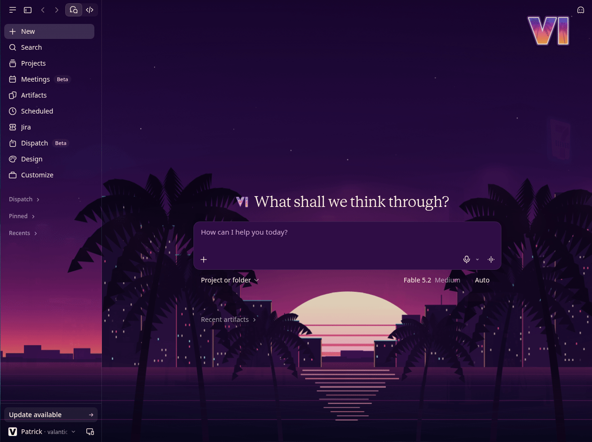

# Claude Desktop for Windows (Extra)

[](https://github.com/Romboter/claude-desktop-extra/releases)
[](https://github.com/Romboter/claude-desktop-extra/actions/workflows/upstream-sync.yml)

**Anthropic's official Claude Desktop for Windows, with extras on top:** separate profiles, themes, Code tab add-ons and custom models. It is experimental and unofficial.

Everything else (Chat, Cowork, Claude Code, sign-in) is Anthropic's own app, unchanged. This project downloads Anthropic's Windows package, patches it, and republishes it as a portable zip for x64 and arm64. A new Anthropic version is picked up and rebuilt automatically.

> This is an unofficial build. It is not made or supported by Anthropic. "Claude" is Anthropic's.

## What you get

- **Profiles:** several separate Claude instances side by side. Each has its own sign-in, settings and Claude Code configuration.
- **Settings → Extra**, with four panels:
  - **Themes:** the [theme engine](https://github.com/Romboter/claude-desktop-extra/blob/master/docs/themes.md), bundled palettes, and a picker on <kbd>Ctrl</kbd>+<kbd>Shift</kbd>+<kbd>T</kbd>.
  - **Community:** opt-in features. These are diff view modes, panel tabs and files quick open (<kbd>Ctrl</kbd>+<kbd>P</kbd>) in the [Code tab](https://github.com/Romboter/claude-desktop-extra/blob/master/docs/code-tab.md); loading large sessions in full; non-Anthropic models; a theme picker; developer tools; the [Jira issue tracker](https://github.com/Romboter/claude-desktop-extra/blob/master/docs/jira-tracker.md) (<kbd>Ctrl</kbd>+<kbd>Shift</kbd>+<kbd>J</kbd>); and an [auto-archive delay](https://github.com/Romboter/claude-desktop-extra/blob/master/docs/auto-archive-grace.md) after a PR merges or closes.
  - **Models:** [custom models](https://github.com/Romboter/claude-desktop-extra/blob/master/docs/custom-models.md) from other providers in the Code tab's picker.
  - **Anthropic:** [feature flag overrides](https://github.com/Romboter/claude-desktop-extra/blob/master/docs/feature-flags.md).

Left out because Windows has its own, or because they are Linux plumbing: the Linux fixes, the Computer Use bridges, Linux window controls, the Quick Entry socket, and the Deployment panel (Windows reads managed settings from the registry).

## Install

1. Download `claude-desktop-extra-<version>-windows-x64.zip` (or `-arm64`) from a [`windows-v<version>` release](https://github.com/Romboter/claude-desktop-extra/releases). Every release tagged `windows-v…` is a Windows build.
2. Unzip it and double-click **Install.cmd**. It unpacks the app to `%LOCALAPPDATA%\Programs\Claude Desktop Extra` and adds **Claude (Extra)** to the Start Menu. No administrator rights are needed.
3. Windows may show "Windows protected your PC". Click **More info → Run anyway**. See [Signing](#signing) for why.

To update, install the next zip the same way. Your data and sign-in are kept. The app does not update itself, but it tells you when a newer build exists: it checks this repository's releases about a minute after start, then every 12 hours, and shows one dialog per new version. Set `CDB_UPDATE_NOTICE=0` to turn that off. `Install.cmd -Uninstall` removes the app and keeps your data.

If the official Claude app is installed too, both use the same data folder and you stay signed in, but only one can run at a time. Quit the official app first.

## Profiles

```bat
Install.cmd -Profile work            :: adds "Claude (work)" to the Start Menu
Install.cmd -Profile work -Desktop   :: and to the desktop
Install.cmd -RemoveProfile work      :: removes the shortcut, keeps the data
```

A profile keeps its own data in `%APPDATA%\Claude-work` and its Claude Code configuration in `%USERPROFILE%\.claude-work`. Details and limits are in the [Windows guide](https://github.com/Romboter/claude-desktop-extra/blob/master/docs/windows.md#profiles).

## The "Extra" settings

Settings → **Extra** holds everything this project adds, with no config file needed:

- **[Themes](https://github.com/Romboter/claude-desktop-extra/blob/master/docs/themes.md)**: pick one of 138 palettes and 48 animated SVG backdrops (or your own), applied live across Chat, Cowork and Code.
- **[Community](https://github.com/Romboter/claude-desktop-extra/blob/master/docs/patches.md#community-features)**: opt-in switches such as files quick open, panel tabs, diff view modes and custom models.
- **[Models](https://github.com/Romboter/claude-desktop-extra/blob/master/docs/custom-models.md)**: providers and models for the Code tab's model picker.
- **[Anthropic](https://github.com/Romboter/claude-desktop-extra/blob/master/docs/feature-flags.md)**: every upstream feature flag as a switch.


<details>
<summary><b>The other Extra pages</b></summary>

| Themes | Models |
|---|---|
|  |  |
| **Anthropic** | |
|  | |
</details>

### The Code tab as an IDE

Three Community switches make the Code tab work like VS Code:

- **Files quick open:** <kbd>Ctrl</kbd>+<kbd>P</kbd> finds a file and opens it in the Files panel; `path:42` jumps to a line, and words match in any order (`user service` finds `user-service.spec.ts`).
- **Panel tabs:** diff, terminal, browser and files open as tabs instead of a shrinking split; each gets the full width and keeps its state, <kbd>Ctrl</kbd>+<kbd>1</kbd>-<kbd>9</kbd> switches.
- **Diff view modes:** the diff panel shows Working tree, Branch changes or Latest turn, against the branch you actually forked from, with expand/collapse all.

Off by default; turn them on in Settings → Extra → Community. Details: [docs/code-tab.md](https://github.com/Romboter/claude-desktop-extra/blob/master/docs/code-tab.md).


## Custom themes

138 dual light/dark palettes and 48 live animated SVG backdrops with frosted-glass panels across **Chat, Cowork and Code**, including **Gaming** (the **GTA I-VI** series, `mario`, `zelda`, `final-fantasy`, `warcraft`, `dragonball`, `playstation`, `gameboy`), 20 **Scenes** from Anthropic's [Claude Code interface mod examples](https://code.claude.com/docs/en/plugins/mods/interface#put-a-backdrop-behind-the-conversation) and 84 community palettes. Press <kbd>Ctrl</kbd>+<kbd>Shift</kbd>+<kbd>T</kbd> (or open Settings → Extra → Themes) to switch themes and backdrops live. Your own themes go in `themes.d\` in the profile folder. Guide: [docs/themes.md](https://github.com/Romboter/claude-desktop-extra/blob/master/docs/themes.md), gallery: [themes/PALETTES.md](https://github.com/Romboter/claude-desktop-extra/blob/master/themes/PALETTES.md).

| GTA I (1997 top-down chase) | GTA VI (Vice City neon) | Winter / Snow Pines |
|---|---|---|
|  |  |  |

## Custom models

Use models from other providers (DeepSeek, Kimi, GLM, MiniMax, Qwen, OpenRouter, a gateway, or Anthropic's API on your API credit) in the Code tab's model picker, next to Anthropic's. Sessions on them use your own key; everything else stays on your subscription. Off by default: add a provider in Settings → Extra → Models and turn it on. Details: [docs/custom-models.md](https://github.com/Romboter/claude-desktop-extra/blob/master/docs/custom-models.md), Windows notes in the [Windows guide](https://github.com/Romboter/claude-desktop-extra/blob/master/docs/windows.md#custom-models).

**Non-Anthropic models through your gateway:** upstream silently drops gateway model IDs that do not look Anthropic (DeepSeek, Qwen, GLM, Kimi, gpt-oss, ...) from the model list and falls back to the default model. Turn on Settings → Extra → Community → **Allow non-Anthropic models** (opt-in, 3P mode, restart) to keep them in the model list, the picker and running sessions. Recipes: [docs/cookbook/](https://github.com/Romboter/claude-desktop-extra/blob/master/docs/cookbook/).

## Feature flag overrides (advanced)

Override Anthropic's server-side feature flags in `claude-desktop-extra.jsonc` in the profile folder, or flip them in Settings → Extra → Anthropic. Details: [docs/feature-flags.md](https://github.com/Romboter/claude-desktop-extra/blob/master/docs/feature-flags.md); settings files: [Windows guide](https://github.com/Romboter/claude-desktop-extra/blob/master/docs/windows.md#settings-files).

## Signing

Anthropic signs `claude.exe`. The build has to change that file, so its signature no longer verifies, and nobody else signs it. In practice:

- **SmartScreen** may warn once when you run `Install.cmd`.
- **Smart App Control**, if turned on, blocks apps with a broken signature, so this build will not start. It has no per-app exception.
- **Antivirus** may look harder at the exe. The build changes only the asar hash stored inside it.

More in the [Windows guide](https://github.com/Romboter/claude-desktop-extra/blob/master/docs/windows.md#code-signing).

## How it stays current

The **Upstream Sync** workflow runs every 2 hours:

1. It syncs this fork with its upstream.
2. It reads Anthropic's Windows release feed and compares it with the newest published `windows-v` release.
3. It builds and publishes only when upstream changed or Anthropic's version is **higher**. A build is smoke-tested on real Windows runners (x64 and arm64) before anything is published.

If a build fails, the workflow opens an "Automatic update failed" issue and **pauses itself**: nothing is built or merged until the problem is fixed, so a broken build is not retried every 2 hours. While paused, each run reports how far behind Anthropic and upstream the fork is. After a fix, run the workflow by hand with **force_build** ticked. A green run closes the issue and resumes the schedule. Closing the issue also resumes it.

The full build steps, the upstream overlay and the sync rules are in the [Windows guide](https://github.com/Romboter/claude-desktop-extra/blob/master/docs/windows.md).

## Troubleshooting

Logs are in `%APPDATA%\Claude\logs\` (a named profile: `%APPDATA%\Claude-<name>\logs\`). Start with the [Windows troubleshooting guide](https://github.com/Romboter/claude-desktop-extra/blob/master/docs/windows-troubleshooting.md): it covers the app not starting, sign-in, custom models and settings files.

**Reporting a bug:** attach `claude-patches.log` and say which `windows-v` release and architecture you installed.

## Patches

The build patches Anthropic's `app.asar`: [community](https://github.com/Romboter/claude-desktop-extra/blob/master/docs/patches.md#community-features) (opt-in features), [core](https://github.com/Romboter/claude-desktop-extra/blob/master/docs/patches.md#core-infrastructure) (infrastructure) and a small Windows set (profiles, the update notice). A patch that stops matching fails the build, and a patch is removed once Anthropic ships the behavior. Catalog: [docs/patches.md](https://github.com/Romboter/claude-desktop-extra/blob/master/docs/patches.md).

## Development

```bash
scripts/windows/build-windows.sh --out dist   # Node 24+, Nim + regex, asar
```

Build steps, the upstream overlay and the checks for a change are in the [Windows guide](https://github.com/Romboter/claude-desktop-extra/blob/master/docs/windows.md#how-it-is-built). To add a feature, write one patch following [Adding your own feature](https://github.com/Romboter/claude-desktop-extra/blob/master/docs/patches.md#adding-your-own-feature).

## Linux

This repository is a fork of [patrickjaja/claude-desktop-extra](https://github.com/patrickjaja/claude-desktop-extra), which packages Claude Desktop for Linux. This fork does not publish Linux packages. For Linux, use the upstream project; its README is still in this repository as [README.md](https://github.com/Romboter/claude-desktop-extra/blob/master/README.md).

## See also

- [tweakcc](https://github.com/Piebald-AI/tweakcc): a CLI tool for customizing Claude Code (system prompts, themes, UI). Same patching-JS-to-make-it-yours energy.

## Credits and license

- Linux project, patch framework and extras: [Patrick Jaja](https://github.com/patrickjaja).
- Windows build layer (profiles, packaging, Windows patch set): [stratosjl](https://github.com/stratosjl/claude-desktop-extra).
- Claude Desktop is Anthropic's.

Released under the [MIT License](https://github.com/Romboter/claude-desktop-extra/blob/master/LICENSE).

## Legal notice

> This is an **unofficial community project** for educational and research purposes. Claude Desktop is proprietary software owned by **Anthropic PBC**. This repository contains only build scripts and patches, not the Claude Desktop application itself; the Windows package is downloaded directly from Anthropic during the build. This project is not affiliated with, endorsed by, or sponsored by Anthropic. "Claude" is a trademark of Anthropic PBC.
