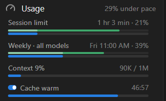

# Usage and session status (Windows)

Settings -> Extra -> Community -> **Usage and session status**. Off by default; it applies live to open chats, no restart. A port of [UI+ for Claude](https://github.com/LukasvanUden/ui-plus-for-claude) (MIT, (c) Lukas van Uden) into the Windows build.

## What it shows

- **Usage row in the sidebar**: the session limit and the weekly limits as bars, with a thin time line above each bar showing how much of that window has passed. Next to **Usage** it says how far over or under pace you are for the week ("on pace" is within three points). Click **Usage** to fold the bars away.

  | Time line | Means |
  |---|---|
  | grey | usage and time agree |
  | green | time is ahead of usage: room to spare |
  | orange | usage is ahead of time: too fast |
  | red | too fast, and Claude already marks the limit as close |

- **Cache warm row** under **Context**, for the open Code session: a switch, a countdown to when that session's prompt cache lapses, and a bar that drains with it.

  

  The switch turns the [cache warmer](windows-patches.md) on or off for this session only; it is remembered across restarts. It needs the **Cache warmer** setting on (Settings -> Extra -> Community Features); with that off, the row says "off in Settings" and the switch is disabled. Next to the countdown:

  | Text | Means |
  |---|---|
  | `46:57` | time left on the cache; the bar shows the share of the 5 minute or 1 hour window |
  | `46:57 · 2 pokes` | the warmer has kept the cache alive this many times since your last message |
  | `46:57 · not warming` | switched off for this session; the cache will lapse on its own |
  | no cache seen | nothing to warm yet: no turn with a cache has finished in this session |
  | expired | the cache lapsed |
  | stopped: time limit / cost limit | the warmer gave up at its hours or rewrites limit |
  | went cold | a poke missed the cache, so warming stopped |

  Switching back on re-arms the warmer if the cache is still alive.

- **State on each session** in the sidebar: a turning gear while Claude works, a still gear with **Waiting** (needs your answer), **Ready** (an unread response) or **Error**; idle sessions show nothing. Side sessions get the same.
- **Usage popover** (the ring below the message box): pace lines above every limit, and the session's context in Claude's own bar colored by what fills it, with **Compact session** once Claude offers it (from 50%), or **Show session rail** while the rail is hidden.
- **Session colors**: right-click a session (or its "..." button) and pick a color in Claude's menu (five colors taken from the active theme's palette, so they change with the theme); it shows as a stripe and tint on the row, saved per session.

English and German, light and dark follow Claude.

## How it works

`js/usage_status_main.js` (main process) injects `js/usage_status_page.js` and `js/usage_status.css` into claude.ai pages on `dom-ready` when the key `usageStatus` is true in `claude-desktop-extra.json` (the `.jsonc` wins and locks the switch). The page script reads your plan usage with the page's own sign-in from `/api/organizations/<id>/usage`; nothing is sent anywhere else. It polls once a minute and not while the window is hidden. With the switch off, it removes everything it added. Third-party (`app://localhost`) pages are left alone.

`patches/windows/add_usage_status.nim` appends the main module to `index.pre.js`; the settings row and its IPC channel (`cdb-usage-status:read` / `:set`) come from `scripts/windows/overlay/20-extra-settings.patch` and `10-build-plumbing.patch`. Startup logs `[usage-status] installed (main)` in `claude-patches.log`.

The Cache warm row works between this module and `js/cache_warm.js`. The per-session off list is a JSON array of session ids in `cache-warm-off.json` in the profile's data folder; the warmer reads it through `globalThis.__cdbCwIsOff`. A click on the switch reaches the main process as the console message `__cdb-cw:<sessionId>:<0|1>` (0 = off). The warmer calls `globalThis.__cdbCwChanged` when its state changes, and the module pushes a snapshot (every 10 seconds as well) to the pages through `window.__cdbCwPush`. Each switch is logged as `[usage-status] cache-warm <session> on|off`. The countdown ticks once a second in the page, and only while it is showing a live countdown.

## Differences from UI+

No in-popover on/off rows and no "Uninstall..." (use the switch), no update check (the build has its own update notice), no browser-extension slot.

## If something does not show

The page script follows Claude's own DOM (sidebar classes, the usage popover's `/settings/usage` link, `data-rail-context-*`). After a Claude update a part can stop matching: it then stays out of the way rather than breaking the app. Switch the feature off and on again after an update, and report what is missing.
